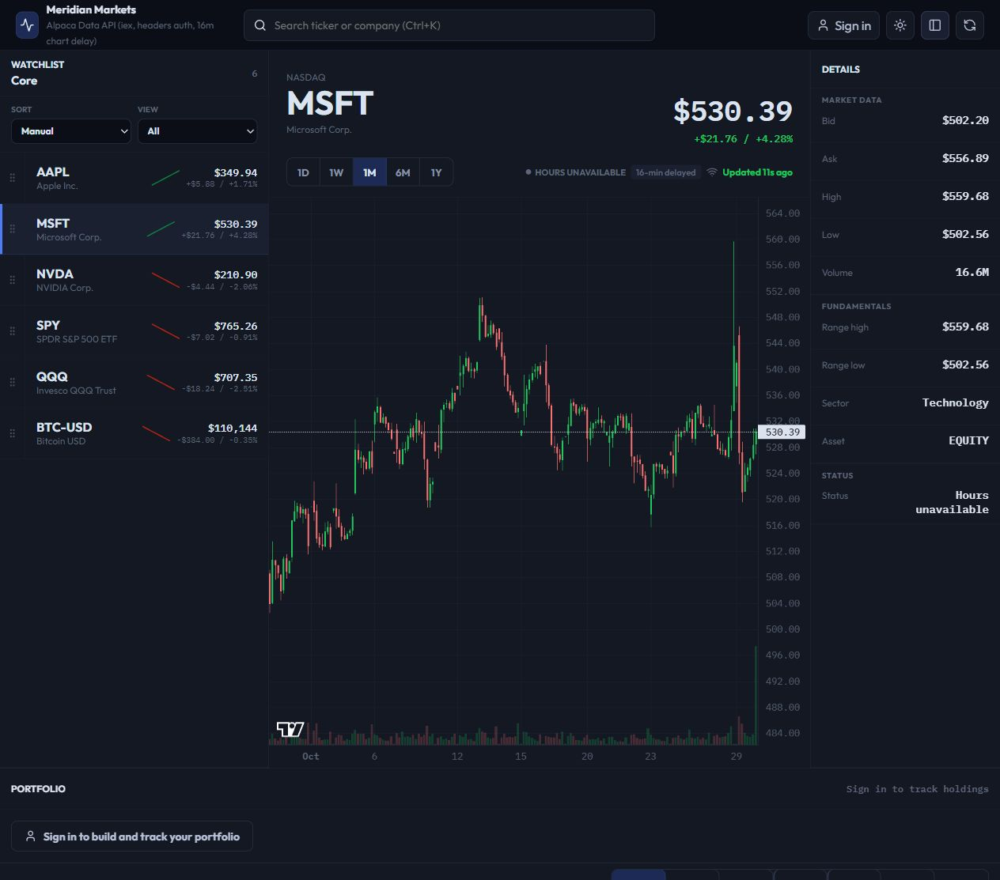

# Meridian Markets

A market-data workspace with charts, symbol search, watchlists, and portfolios.

[Open the dashboard](https://market-data-dashboard-production.up.railway.app/)



MSFT selected with the 1M chart. This capture displays 16-minute delayed data and an unavailable market-hours status. The app initially showed demo fallback while loading; displayed values are not independently verified.

## The problem

Price history, quotes, watchlists, and portfolio information are often spread across separate views. Meridian brings them into one dashboard and explores the application structure needed to connect an interactive frontend to market providers and persistent user data.

This is a demonstration application. Some views use fallback data, and live coverage depends on provider access.

## Try it in one minute

1. Open the dashboard and select a symbol from the watchlist.
2. Change the chart timeframe and inspect the instrument details.
3. Try symbol search and adjust the dashboard layout.
4. For account-dependent features, follow the app's sign-in flow.

Treat displayed values as demonstration data: feeds may be delayed, synthetic, or unavailable.

## Engineering work in this repository

The project includes the dashboard UI, market-data hooks and clients, server-side provider adapters, account handling, and SQLite persistence. The layout-preference extraction separates parsing, persistence, state, and controls from the main application component.

Charts and tables use supporting libraries. Market prices and fundamentals come from external providers; the repository implements the application that requests, stores, and presents that information.

## Architecture

```text
React + TypeScript dashboard
  ├─ Components: charts, watchlists and portfolio views
  ├─ Hooks and services: loading, refresh and API access
  └─ Layout feature: preferences, state and controls
             │
             ▼
Node.js HTTP server
  ├─ Market adapters → Alpaca / Yahoo Finance
  └─ Account and user storage → SQLite
```

Market credentials stay on the server. Account data is stored in SQLite; hosted deployments need persistent storage. The frontend and backend are deployed together through the repository's Node/Docker setup.

## Key decisions and tradeoffs

- **Put providers behind server-side adapters.** Credentials stay out of the frontend and provider integration has a defined boundary. Provider permissions, availability, and schema changes still affect the application.
- **Use SQLite for persistence.** A local database keeps the deployment compact. It requires deliberate volume configuration and a backup plan; this repository does not establish a distributed database architecture.
- **Allow demo-data fallback.** The dashboard can illustrate interactions when live data is unavailable. This means successful rendering is not evidence that every value is live.
- **Refactor incrementally.** Layout settings now have a focused feature boundary and regression tests. Further separation of responsibilities in the main application remains worthwhile.

## Current limits

Some Yahoo Finance fundamentals responses fail schema validation, so fields can remain missing even when the application builds and tests pass. Smoke tests use local data and do not establish live-feed correctness.

Optional chat, email, and notification features need separate service configuration. The repository contains no customer database or live trading credentials. This is not a trading execution system.

## Run locally

Use Node.js 24; the server uses `node:sqlite`.

```sh
npm ci
npm run dev
```

Open [localhost:5180](http://localhost:5180). For live data, copy `.env.example`
to `.env` and add your own Alpaca credentials. The database is created locally;
the repository does not include user accounts or portfolios.

## Checks

```sh
npm run check
```

This runs lint, smoke tests, and the production build. GitHub Actions runs the same
checks on pushes and pull requests. Each command can also be run separately.

Smoke tests cover authentication, market endpoints, and strategy behavior. They
use local test data. For a production-style local run, build first and run
`npm start`, which defaults to port 4173 unless `PORT` is set.

## Implementation

| Location                                     | Responsibility                                    |
| -------------------------------------------- | ------------------------------------------------- |
| `src/components/`                            | Charts, watchlists, portfolio, and analysis views |
| `src/hooks/useMarketData.ts`                 | Loading and refresh behavior                      |
| `src/services/`                              | API clients and demo data providers               |
| `server/alpacaClient.mjs`                    | Market provider requests                          |
| `server/authApi.mjs`, `server/userStore.mjs` | Accounts and SQLite storage                       |
| `server/start.mjs`                           | Production HTTP server                            |

The source also includes screeners, strategy tools, and an optional market chat.
Chat uses Ollama or Groq and needs its own service configuration. Email and
notifications also need separate configuration. These are application features,
not requirements for running the core dashboard.

## Deployment

`Dockerfile` and `railway.json` describe the Node deployment. Set credentials in
the hosting environment, set `PORT` for the service, and point `DATA_DIR` at
persistent storage. GitHub Pages cannot run the Node/SQLite backend.

This is a demonstration application. Data may be delayed or synthetic, and the
repository does not include live trading credentials or customer data.
